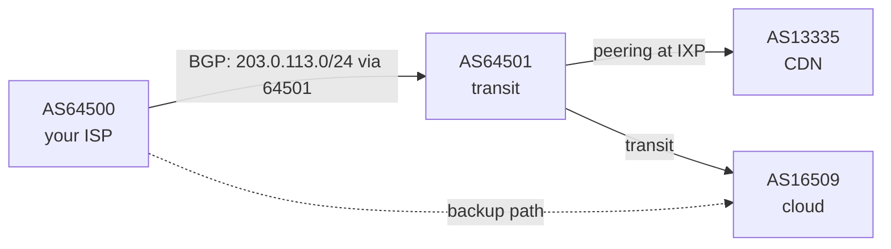

## Context

"The internet" isn't one network. It's tens of thousands of independently run networks that agreed to speak the same protocols and pass each other's traffic. Once you understand that, everything else in this series (IP addresses, DNS, TLS) slots into place.

## 1. Packets, not wires

When you load a web page, your data isn't sent as one continuous stream down a dedicated line. It's chopped into **packets**: small chunks, typically up to ~1,500 bytes (the Ethernet **MTU**). Each one carries:

- a **source and destination IP address** (where it came from, where it's going),
- protocol headers (TCP/UDP ports, sequence numbers),
- the **payload**: a slice of your actual data.

Each packet is routed independently. They can take different paths and arrive out of order; the receiving end (TCP, see Part 4) puts them back together. This is **packet switching**, and it's why the internet survives links failing: traffic simply routes around them.

## 2. The path from your laptop



1. **Your device** sends the packet to its **default gateway**, your home router.
2. **The home router** rewrites your private address to its single public one (**NAT**, Part 3) and forwards it to your **ISP**.
3. **The ISP** routes it through its own network and then hands it to another network. That's either a **transit provider** it pays, or a **peer** it swaps traffic with for free, often at an **Internet Exchange Point (IXP)** such as AMS-IX in Amsterdam or DE-CIX in Frankfurt.
4. **The destination** is reached after a few such handoffs. That's usually a **CDN edge** or a cloud region close to you, not a single server on the other side of the world.

Run `traceroute example.com` (or `mtr`) to see each router hop on the way.

## 3. Autonomous systems and BGP

Every independently run network (an ISP, a cloud provider, a big company) is an **Autonomous System (AS)** with a number, e.g. AS15169 for Google or AS16509 for AWS. Each AS announces the IP ranges it owns to its neighbours using **BGP (Border Gateway Protocol)**:

> "I can reach 203.0.113.0/24, and the path is AS64500 → AS64501."

Routers pick the best path based on policy (cost, business relationships) more than distance. BGP is the "glue" of the internet, and also a famous single point of failure: a bad announcement can take a company offline, as happened to Facebook in 2021. **RPKI** (cryptographically signed route origins) is now widely deployed to stop accidental and malicious route hijacks.

## 4. The physical layer is real

- **Undersea cables** carry over 95% of intercontinental traffic. Hyperscalers (Google, Meta, Microsoft, Amazon) now own or co-own many of them.
- **Fibre** carries the backbone, and increasingly runs to the home too (FTTH).
- **Last mile**: fibre, cable (DOCSIS), DSL, 4G/5G, and low-earth-orbit satellite (Starlink and others) for remote areas.
- **Data centres** cluster where power, fibre and IXPs meet.

## 5. CDNs: bringing content closer

Light in fibre covers about 200 km per millisecond, so a round trip Amsterdam ↔ San Francisco is ~140 ms before any processing. **CDNs** (Cloudflare, Akamai, Fastly, CloudFront) solve this by caching content in hundreds of cities and terminating connections at the edge (Part 8). Most "websites" you visit are actually served from a few milliseconds away.

## 6. Who runs the shared bits?

| Body | What it does |
|---|---|
| **IETF** | Writes the protocol standards (RFCs): IP, TCP, HTTP, TLS, QUIC |
| **ICANN / IANA** | Coordinates the DNS root, top-level domains and IP/AS number pools |
| **RIRs** (RIPE NCC, ARIN, APNIC, …) | Allocate IP addresses and AS numbers per region |
| **W3C / WHATWG** | Web standards (HTML, browser APIs) |

## Lessons learned

The internet is a network of networks: packets hop from your router to your ISP, across peering and transit links chosen by BGP, to an edge server near you. Each later part of this series zooms in on one layer of that journey. Next: the **OSI and TCP/IP models**, the map we use to talk about those layers.
