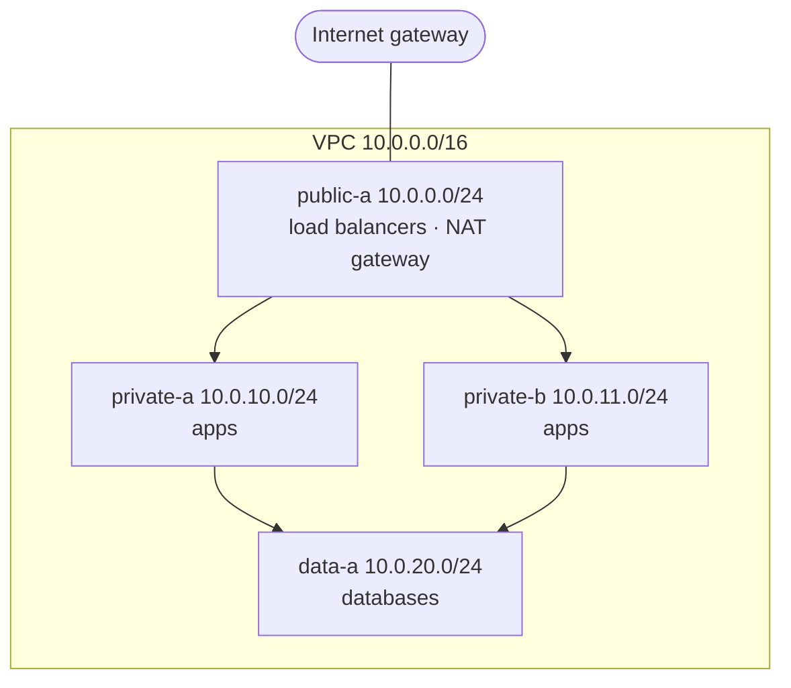
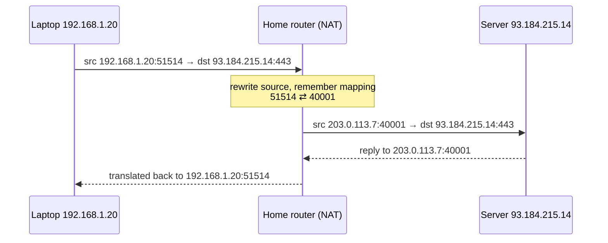

## Context

Every device on a network needs an address, and every service on that device needs a door number. Those are **IP addresses** (layer 3) and **ports** (layer 4). Getting comfortable with CIDR and private ranges pays off the first time you design a VPC or debug a Kubernetes cluster.

## 1. IPv4

An IPv4 address is 32 bits, written as four bytes: `192.168.1.20`. That's only ~4.3 billion addresses, which ran out at the regional registries in the 2010s. IPv4 addresses are now bought and sold, and AWS charges for every public IPv4 address.

## 2. CIDR and subnets

**CIDR notation** says how many leading bits are the *network* part:

```text
10.0.0.0/16   → first 16 bits fixed → 65,536 addresses (10.0.0.0 – 10.0.255.255)
10.0.1.0/24   → first 24 bits fixed → 256 addresses   (10.0.1.0 – 10.0.1.255)
10.0.1.0/28   → first 28 bits fixed → 16 addresses
```

The rule: a `/n` network has **2^(32−n)** addresses. Bigger prefix, smaller network.

A **subnet** is a slice of a larger network. A typical cloud VPC looks like:



Cloud providers reserve a few addresses in every subnet (AWS reserves 5). Plan big: Kubernetes with VPC-native pod networking can use **one IP per pod**.

## 3. Private ranges and special addresses

| Range | Use |
|---|---|
| `10.0.0.0/8`, `172.16.0.0/12`, `192.168.0.0/16` | **Private** (RFC 1918). Not routed on the internet |
| `100.64.0.0/10` | Carrier-grade NAT (also used by Tailscale) |
| `127.0.0.0/8` | Loopback, i.e. "this machine" (`localhost`) |
| `169.254.0.0/16` | Link-local. Cloud metadata lives at `169.254.169.254` |
| `0.0.0.0` | "All interfaces" when a server binds to it |

## 4. NAT: sharing one public address

Your home has one public IPv4 address but many devices. The router does **Network Address Translation**:



- **Outbound connections work** without any setup.
- **Inbound connections are blocked by default**, which is why you need port forwarding, a tunnel or a load balancer to expose a service.
- **In the cloud**, a **NAT gateway** gives private subnets outbound internet access.

## 5. IPv6

IPv6 addresses are 128 bits, written in hex: `2001:db8:85a3::8a2e:370:7334` (`::` compresses runs of zeros).

- **There are effectively unlimited addresses**, so no NAT is needed. Every device can have a global address, and you protect it with a firewall instead.
- **A standard subnet is a `/64`**. Devices can configure their own addresses (SLAAC).
- **Adoption keeps growing.** Roughly half of Google's users now reach it over IPv6, and mobile networks lead. Most cloud and Kubernetes setups support dual-stack (IPv4 + IPv6).

## 6. Ports: many services, one address

An IP gets a packet to the machine. The **port** (0–65535) gets it to the right program. A connection is identified by the 5-tuple: **protocol, source IP, source port, destination IP, destination port**.

| Port | Service | | Port | Service |
|---|---|---|---|---|
| 22 | SSH | | 443 | HTTPS (TCP), HTTP/3 (UDP) |
| 25/587 | SMTP (mail) | | 3306 | MySQL |
| 53 | DNS | | 5432 | PostgreSQL |
| 80 | HTTP | | 6379 | Redis |
| 123 | NTP | | 6443 | Kubernetes API |

- **Ports 0–1023 are well-known.** Binding to them needs root on Linux (or `CAP_NET_BIND_SERVICE`).
- **Clients use ephemeral ports**, randomly picked from a high range (`32768–60999` on Linux).

```bash
ss -tlnp          # what is listening on this machine?
nc -vz db 5432    # can I reach that port?
```

## Lessons learned

IP addresses route packets between networks, and ports deliver them to a program. CIDR (`/24`, `/16`) defines network size. Private ranges plus NAT let billions of devices share scarce IPv4, and IPv6 removes that scarcity. Next: **TCP, UDP and QUIC**, the transport protocols that use those ports.
