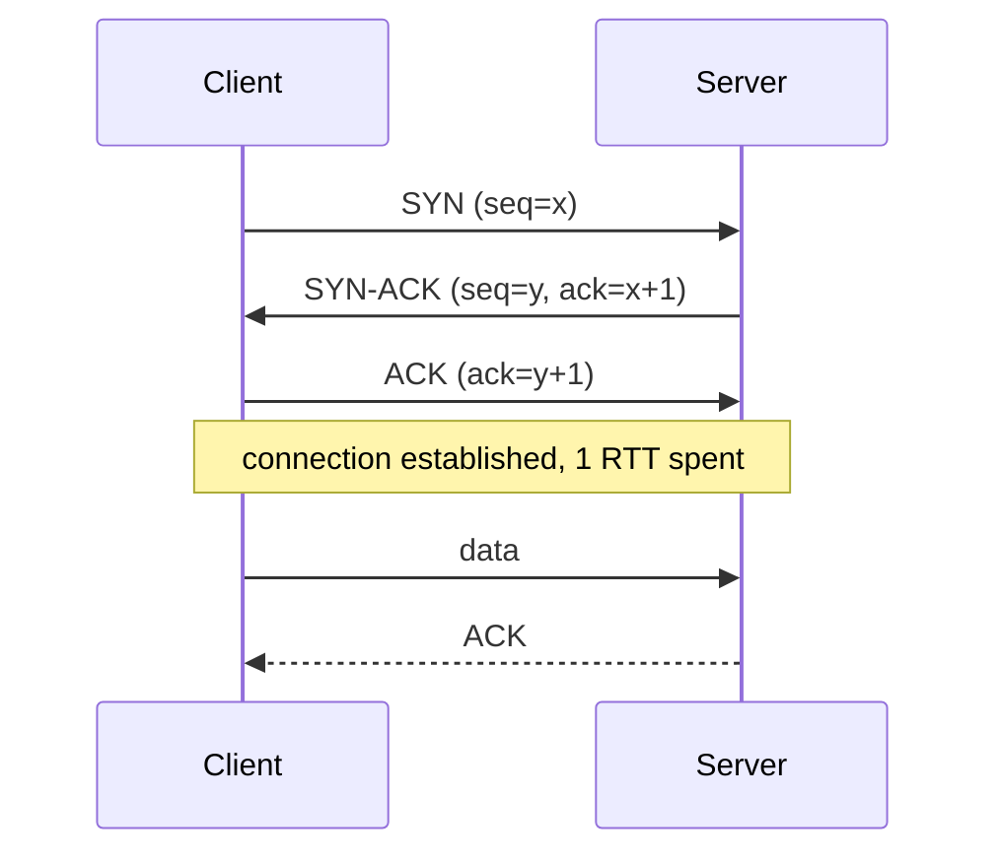
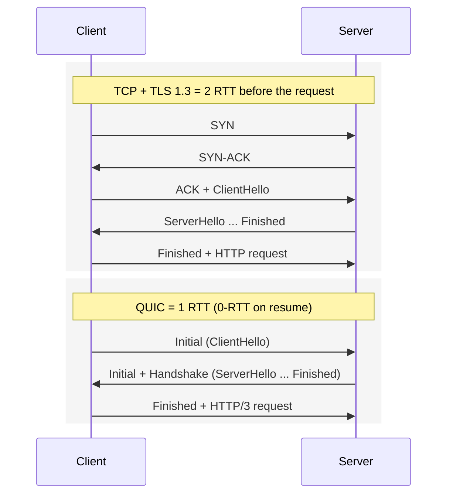

## Context

IP delivers packets on a best-effort basis: they can be lost, duplicated or arrive out of order. The **transport layer** decides what to do about that. Almost everything uses one of three protocols: **TCP**, **UDP** or **QUIC**.

## 1. TCP: a reliable byte stream

TCP gives applications the illusion of a reliable, ordered pipe.

### The three-way handshake



That costs **one round trip (RTT)** before any data flows. Add TLS on top and you pay more (Part 8).

### What TCP does for you

- **Sequence numbers and acknowledgements.** Every byte is numbered, and missing data is **retransmitted**.
- **Ordering.** Out-of-order segments are buffered and delivered in order.
- **Flow control.** The receiver advertises a *window* so a fast sender can't overwhelm it.
- **Congestion control.** The sender probes for available bandwidth and backs off on loss. Linux defaults to **CUBIC**, and Google's **BBR** models bandwidth and delay instead of reacting only to loss.

### Closing and TIME_WAIT

Connections close with FIN/ACK in each direction. The side that closes first sits in `TIME_WAIT` for a while. Thousands of short-lived connections can exhaust ephemeral ports, which is one reason we use **connection pooling** and keep-alive.

### Head-of-line blocking

Because TCP delivers bytes strictly in order, one lost packet stalls everything behind it, even data belonging to unrelated HTTP requests multiplexed on the same connection.

## 2. UDP: fire and forget

UDP adds just ports and a checksum to IP. There's no handshake, no retransmission and no ordering.

Use it when **speed matters more than perfection**, or when the app handles reliability itself:

- **DNS queries** (one small question, one small answer)
- **Voice, video and gaming**, where a late packet is worthless anyway
- **Telemetry** such as StatsD and syslog
- **VPN tunnels** (WireGuard)
- **QUIC**

## 3. QUIC: transport rebuilt on UDP



**QUIC** (RFC 9000) runs over UDP but reimplements reliability, ordering and congestion control in user space. TLS 1.3 is built in. It powers **HTTP/3**.

| | TCP + TLS 1.3 | QUIC |
|---|---|---|
| Handshake | TCP (1 RTT) + TLS (1 RTT) | **1 RTT combined**, 0-RTT on resume |
| Encryption | Payload only, TCP headers visible | Nearly everything, including most headers |
| Multiplexing | One stream, head-of-line blocking | **Independent streams**: loss on one doesn't block others |
| Network change | Connection breaks (new IP = new connection) | **Connection migration** via connection IDs (Wi-Fi → 5G) |
| Where it's implemented | OS kernel | Application / library (easier to evolve) |

The trade-offs: UDP is sometimes blocked or rate-limited by corporate firewalls (browsers fall back to TCP), and QUIC uses more CPU than kernel TCP.

## 4. Picking one

| Need | Choose |
|---|---|
| Web APIs, databases, anything that must arrive intact | TCP (or QUIC via HTTP/3) |
| Public websites on mobile and lossy networks | HTTP/3 over QUIC, with TCP fallback |
| Real-time media, games, small queries | UDP (often with RTP/WebRTC on top) |

## 5. See it yourself

```bash
ss -tan state established      # live TCP connections
ss -tan state time-wait | wc -l
sudo tcpdump -ni any 'tcp[tcpflags] & tcp-syn != 0' and port 443   # watch handshakes
curl --http3 -I https://cloudflare.com   # if your curl is built with HTTP/3
```

## Lessons learned

TCP trades latency for reliability: a handshake, retransmissions, ordering and congestion control. UDP trades reliability for simplicity and speed. QUIC takes the best of both, building reliable, encrypted, multiplexed streams on UDP. Next: **DNS**, how a name like `example.com` becomes an IP address in the first place.
