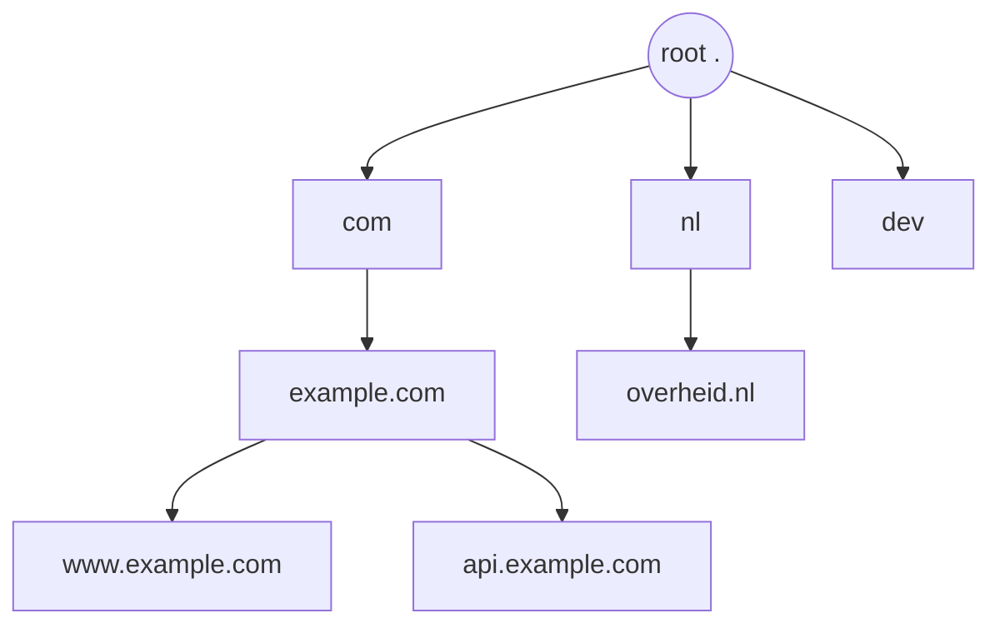

## Context

Computers route by IP address. Humans remember names. **DNS (Domain Name System)** is the distributed, cached, hierarchical database that turns `www.example.com` into `93.184.215.14`. Billions of lookups a day, and "it's always DNS" is an industry joke for a reason.

## 1. Names are a tree



Each level is a **zone** that can be delegated to someone else's name servers. The root delegates `com` to Verisign, `nl` to SIDN, and `example.com` is delegated to whatever name servers its owner configured at their **registrar**.

## 2. A lookup, step by step



1. **Caches first.** The browser, then the OS (`/etc/hosts`, then the local cache), check whether they already know the answer.
2. **The stub resolver asks a recursive resolver.** That's usually your router or ISP, a public resolver such as `1.1.1.1` or `8.8.8.8`, or the cloud's VPC resolver.
3. **The recursive resolver walks the tree** if it has nothing cached:
   - A **root server** points it to the `.com` servers. There are 13 named root server identities, served by over 1,500 anycast instances worldwide.
   - The **TLD server** points it to `example.com`'s authoritative name servers.
   - The **authoritative server** returns the actual record.
4. **The resolver caches the answer** for the record's **TTL** and returns it.

In practice the root and TLD steps are almost always cached, so most lookups take a few milliseconds.

## 3. Record types you'll actually use

| Type | Maps | Example |
|---|---|---|
| **A** | name → IPv4 | `www  A  93.184.215.14` |
| **AAAA** | name → IPv6 | `www  AAAA  2606:2800::1` |
| **CNAME** | name → another name (alias) | `docs  CNAME  myorg.github.io.` |
| **MX** | mail servers for a domain | `@  MX  10 mail.example.com.` |
| **TXT** | free text: SPF, DKIM, DMARC, domain verification | `@  TXT  "v=spf1 include:_spf.google.com -all"` |
| **NS** | which servers are authoritative | `@  NS  ns1.provider.net.` |
| **CAA** | which CAs may issue certificates (Part 7) | `@  CAA  0 issue "letsencrypt.org"` |
| **SRV** | service host and port | used by SIP, LDAP, some Kubernetes tooling |
| **HTTPS / SVCB** | connection hints: HTTP/3 support, ECH keys, alt endpoints | `@  HTTPS  1 . alpn="h3,h2"` |

**A CNAME can't sit at the zone apex** (`example.com` itself). Providers work around this with ALIAS/ANAME records or Route 53 *alias* records.

## 4. TTL and caching

The **TTL** (in seconds) says how long resolvers may cache an answer.

- **Long TTLs** (hours) mean fewer queries, but changes propagate slowly.
- **Short TTLs** (30–300 s) mean fast failover and migrations, at the cost of more queries.
- **Before a migration**, lower the TTL a day ahead, switch the record, then raise it again.

"DNS propagation" is really just old cached answers expiring.

## 5. Security and privacy

- **DNSSEC** signs records so resolvers can verify they weren't tampered with. It protects integrity, not privacy.
- **DoT / DoH / DoQ** (DNS over TLS, HTTPS or QUIC) encrypt the query between you and the resolver. Browsers and OSes increasingly use DoH by default.
- **Encrypted Client Hello (ECH)** uses keys published in HTTPS records to hide which site you're connecting to, even from your ISP.
- **Watch for dangling records.** A forgotten CNAME pointing at a deleted cloud resource enables *subdomain takeover*.

## 6. DNS in Kubernetes

CoreDNS gives every Service a name:

```text
my-svc.my-namespace.svc.cluster.local  →  ClusterIP
```

A pod's `/etc/resolv.conf` has `search` domains and `ndots:5`, so a short name like `api` is tried against several suffixes first. External lookups for names with fewer than five dots go through those suffixes before the real query. For hot paths, use a fully qualified name with a trailing dot (`api.example.com.`) or enable NodeLocal DNSCache.

## 7. Tools

```bash
dig www.example.com              # A record, with TTL and the server that answered
dig +trace www.example.com       # walk root → TLD → authoritative yourself
dig MX example.com +short
dig @1.1.1.1 example.com AAAA    # ask a specific resolver
nslookup example.com             # quick check, also on Windows
```

## Lessons learned

DNS is a delegated tree plus a lot of caching. Recursive resolvers walk root → TLD → authoritative, and TTLs control how long answers live. Know your record types, keep TTLs short before changes, and clean up dangling records. Next: **HTTP and HTTPS**, what your browser says once it has the IP.
