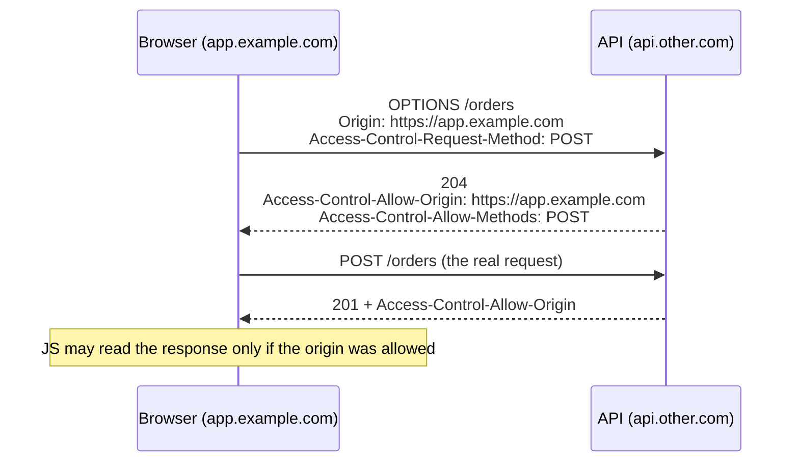

## Context

**HTTP** is the language of the web and of most APIs. It's a simple request/response protocol: the client asks, the server answers. **HTTPS** is the same protocol carried inside TLS. Everything from a browser loading a page to `kubectl` talking to the API server speaks it.

## 1. A request and a response

```http
GET /api/orders/42 HTTP/1.1
Host: shop.example.com
Accept: application/json
Authorization: Bearer eyJhbGciOi...
User-Agent: curl/8.10
```

```http
HTTP/1.1 200 OK
Content-Type: application/json
Cache-Control: private, max-age=60
Content-Length: 57

{"id":42,"status":"shipped","items":3,"total":"49.90"}
```

A request is a **method**, a **path**, **headers**, and an optional **body**. A response is a **status code**, headers and a body.

## 2. Methods

| Method | Meaning | Safe? | Idempotent? |
|---|---|---|---|
| `GET` | Read a resource | ✅ | ✅ |
| `HEAD` | GET without the body | ✅ | ✅ |
| `POST` | Create, or trigger an action | ❌ | ❌ |
| `PUT` | Replace a resource | ❌ | ✅ |
| `PATCH` | Partially update | ❌ | ❌ (usually) |
| `DELETE` | Remove | ❌ | ✅ |
| `OPTIONS` | Ask what's allowed (CORS preflight) | ✅ | ✅ |

**Idempotent** means repeating it has the same effect as doing it once, which tells you what's safe to retry.

## 3. Status codes

| Range | Meaning | Ones to know |
|---|---|---|
| **1xx** | Informational | `101` Switching Protocols (WebSocket), `103` Early Hints |
| **2xx** | Success | `200` OK, `201` Created, `204` No Content |
| **3xx** | Redirect | `301`/`308` permanent, `302`/`307` temporary, `304` Not Modified |
| **4xx** | Client's fault | `400` Bad Request, `401` Unauthenticated, `403` Forbidden, `404` Not Found, `409` Conflict, `429` Too Many Requests |
| **5xx** | Server's fault | `500` Internal Error, `502` Bad Gateway, `503` Unavailable, `504` Gateway Timeout |

`502` and `504` usually come from a **proxy or load balancer** that couldn't get a good answer from the backend. Check the upstream service, not the proxy.

## 4. Headers that matter

- **Content**: `Content-Type`, `Content-Length`, `Content-Encoding` (gzip, br, zstd)
- **Caching**:
  - `Cache-Control` (`max-age`, `no-store`, `private`, `immutable`)
  - `ETag` and `If-None-Match`, which let the server answer `304 Not Modified`
- **Auth**: `Authorization: Bearer <token>`, `WWW-Authenticate`
- **State**: `Set-Cookie` / `Cookie`, with flags:
  - `HttpOnly` (hidden from JavaScript)
  - `Secure` (sent over HTTPS only)
  - `SameSite=Lax|Strict|None` (controls cross-site sending)
- **Proxies**: `X-Forwarded-For`, `X-Forwarded-Proto`, or the standard `Forwarded`, which tell the app the real client IP and scheme
- **Security**:
  - `Strict-Transport-Security` (HSTS: "always use HTTPS")
  - `Content-Security-Policy`
  - `X-Content-Type-Options: nosniff`

## 5. HTTP is stateless, so we add state

Each request stands alone. Sessions are layered on top:

- **Session cookie.** The server stores the session and the cookie holds its ID.
- **Token.** The client sends a signed token (e.g. a JWT) on every request (Part 9).

## 6. CORS in one paragraph

Browsers block JavaScript on `app.example.com` from reading responses from `api.other.com` unless that API allows it. For "non-simple" requests the browser first sends an `OPTIONS` **preflight**, and the server must answer with `Access-Control-Allow-Origin` (and friends). CORS is enforced **by the browser**: `curl` ignores it, and it's not a server-side security control.



## 7. HTTPS: HTTP inside TLS

HTTPS = HTTP + **TLS** (Parts 7 and 8), on port 443. It gives you:

- **Confidentiality.** Nobody on the path can read the traffic.
- **Integrity.** Nobody can modify it undetected.
- **Authentication.** The server proves it owns the domain, via its certificate.

Today, HTTPS is the default for the whole web. Browsers label plain HTTP "Not secure", and features like service workers, geolocation and HTTP/2 in browsers require it.

## 8. HTTP/1.1 vs HTTP/2 vs HTTP/3

| | HTTP/1.1 | HTTP/2 | HTTP/3 |
|---|---|---|---|
| Format | Text | Binary frames | Binary frames |
| Transport | TCP | TCP | **QUIC (UDP)** |
| Parallel requests | One at a time per connection (browsers open ~6) | **Multiplexed streams** on one connection | Multiplexed, **no TCP head-of-line blocking** |
| Header compression | None | HPACK | QPACK |
| Typical use | Simple clients, legacy | APIs, **gRPC**, most sites | Mobile, lossy networks, big CDNs |

The semantics (methods, status codes, headers) are identical across all three. Only the wire format changes. A server advertises HTTP/3 support with an `Alt-Svc` header or a DNS **HTTPS record**.

Related protocols built on HTTP: **WebSocket** (a bidirectional channel opened via `101` Upgrade), **Server-Sent Events** (one-way streaming, used by most LLM APIs to stream tokens) and **gRPC** (RPC over HTTP/2 with Protobuf).

## 9. Try it

```bash
curl -v https://example.com                 # see request + response headers + TLS info
curl -sI https://example.com | grep -i cache
curl -X POST -H 'Content-Type: application/json' -d '{"q":"hi"}' https://httpbin.org/post
curl --http2 -I https://example.com
```

## Lessons learned

HTTP is a stateless request/response protocol: methods, status codes and headers carry the meaning, and cookies or tokens add state. HTTPS wraps it in TLS. HTTP/2 and HTTP/3 change only the wire format to cut latency. Next: **certificates**, how a browser knows it's really talking to `example.com`.
