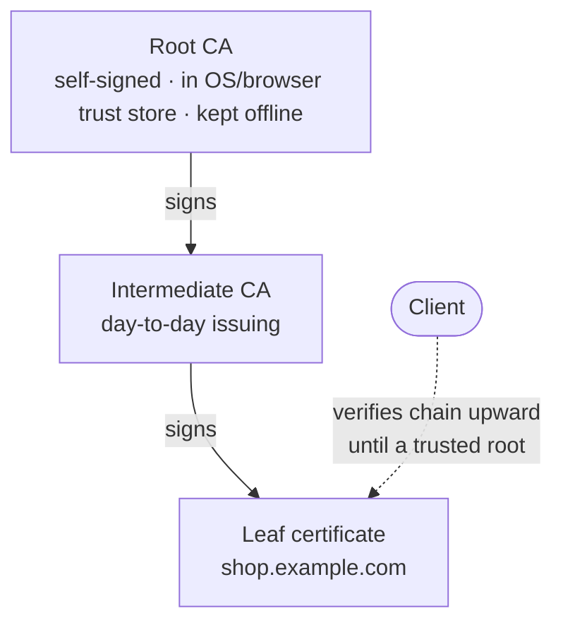

## Context

When your browser shows a padlock for `bank.example`, it's trusting a **certificate**: a signed statement that says "this public key belongs to `bank.example`". Understanding certificates explains most "TLS errors" you'll ever see, and why certificate automation is no longer optional.

## 1. Public-key cryptography in two minutes

Each party has a **key pair**:

- a **private key**, kept secret,
- a **public key**, shared with anyone.

What is encrypted with one key can only be decrypted with the other. Also, a **signature** made with the private key can be checked by anyone holding the public key. Common algorithms are **RSA** (2048/3072-bit) and **ECDSA** (P-256), which is smaller and faster and now the usual choice.

The problem: if a server just sends you its public key, how do you know an attacker didn't swap it? Someone you already trust has to vouch for it.

## 2. What's inside an X.509 certificate

```text
Subject:            CN=shop.example.com
Subject Alt Names:  DNS:shop.example.com, DNS:www.shop.example.com
Issuer:             CN=R11, O=Let's Encrypt
Validity:           Not Before 2026-11-01 / Not After 2027-01-30
Public Key:         ECDSA P-256 (04:9a:...)
Key Usage:          Digital Signature
Extended Key Usage: TLS Web Server Authentication
Signature:          signed by the issuer's private key
```

Browsers match the hostname against the **Subject Alternative Names (SAN)**, not the old CN field. A **wildcard** like `*.example.com` covers one label (`api.example.com`), but not `a.b.example.com` or `example.com` itself.

## 3. Chain of trust



1. **The server sends** its leaf certificate **plus the intermediate(s)**.
2. **The client builds a chain** up to a **root** it already trusts. Roots ship with the OS, the browser (Mozilla, Chrome, Apple and Microsoft each run a root program) or a language runtime.
3. **The client checks every signature**, the validity dates and the hostname.

The #1 real-world mistake is a server that **doesn't send the intermediate**. Browsers often paper over it by fetching the intermediate themselves, but `curl`, Java and mobile apps fail. Always serve the full chain (`fullchain.pem`).

## 4. Who issues certificates, and how they check you

A **Certificate Authority (CA)** must verify that you control the domain before issuing:

| Type | What's checked | Use |
|---|---|---|
| **DV** (Domain Validated) | You control the domain (HTTP-01 file, DNS-01 TXT record, or TLS-ALPN-01) | The vast majority of the web |
| **OV** (Organization Validated) | Plus the organization's legal identity | Some enterprises |
| **EV** (Extended Validation) | Stricter organization checks | Browsers no longer show it specially |

**CAA** DNS records (Part 5) let you say which CAs may issue for your domain. **Certificate Transparency (CT)** requires every public certificate to be logged publicly, so you can monitor for certs issued for your domains (e.g. on crt.sh).

## 5. ACME and Let's Encrypt

**ACME** (RFC 8555) automates the whole cycle: prove control, get the certificate, renew. **Let's Encrypt** (free, the largest CA by volume) popularised it. Clients include **certbot**, **cert-manager** in Kubernetes, and built-in support in Caddy, Traefik and most cloud load balancers.

## 6. Lifetimes are shrinking fast

The CA/Browser Forum has voted to cut maximum public TLS certificate lifetime in steps:

| From | Max validity |
|---|---|
| Before March 2026 | 398 days |
| **15 March 2026** | **200 days** |
| 15 March 2027 | 100 days |
| 15 March 2029 | **47 days** |

Let's Encrypt already issues 90-day certificates, offers **6-day short-lived** certificates, and plans to move its default towards 45 days. The message is clear: **manual renewal is dead.** If a human has to remember to renew it, it will expire in production.

## 7. Revocation

If a private key leaks, the certificate must be **revoked** before it expires.

- **CRLs** are lists of revoked serial numbers published by the CA. They're making a comeback, with browsers aggregating them (e.g. Firefox's CRLite).
- **OCSP** was a per-certificate online check. It's being phased out because of privacy and reliability problems, and Let's Encrypt has shut its OCSP service down.
- **Short lifetimes** are the real answer: a stolen 6-day certificate is useful for days, not months.

## 8. Private PKI and mTLS

Not every certificate is public. Internal services often use a **private CA**, for example HashiCorp Vault PKI, AWS Private CA, cert-manager with a CA issuer, or a **service mesh** (Istio, Linkerd) that issues short-lived workload certificates automatically.

With **mutual TLS (mTLS)** *both* sides present certificates, so service A can prove its identity to service B. **SPIFFE/SPIRE** standardises those workload identities (`spiffe://cluster/ns/payments/sa/api`).

## 9. Certificates in Kubernetes

```yaml
apiVersion: cert-manager.io/v1
kind: Certificate
metadata:
  name: shop-tls
spec:
  secretName: shop-tls          # TLS secret consumed by Ingress / Gateway
  dnsNames: [shop.example.com]
  issuerRef:
    kind: ClusterIssuer
    name: letsencrypt-prod      # ACME issuer, DNS-01 or HTTP-01
```

cert-manager renews automatically, at two-thirds of the lifetime by default.

## 10. Inspect a certificate

```bash
openssl s_client -connect example.com:443 -servername example.com -showcerts </dev/null
echo | openssl s_client -connect example.com:443 2>/dev/null | openssl x509 -noout -subject -issuer -dates -ext subjectAltName
openssl x509 -in cert.pem -noout -text
```

## Lessons learned

A certificate binds a public key to a name and is signed by a CA you trust through a chain. Serve the full chain, match the SANs, and automate issuance with ACME, because lifetimes are heading to 47 days. Next: **the TLS handshake and TLS termination**, where certificates are actually used.
