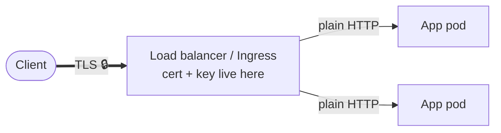
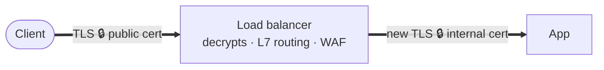
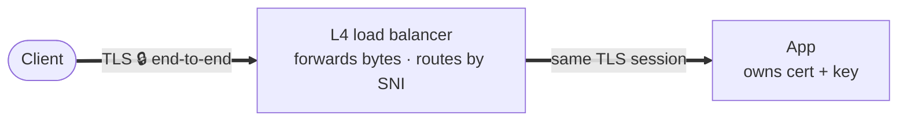
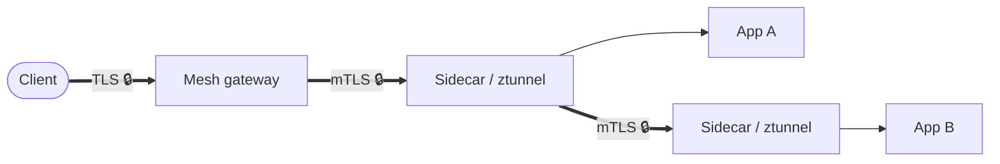

## Context

**TLS (Transport Layer Security)** is what puts the S in HTTPS, and it also secures SMTP, database connections, gRPC and the Kubernetes API. This part covers how two strangers agree on secret keys over a public network, and the architecture question every platform team faces: *where should TLS be terminated?*

## 1. The TLS 1.3 handshake

TLS 1.3 (RFC 8446) needs **one round trip**:



1. **Key exchange.** Both sides combine their ephemeral key shares using (EC)Diffie-Hellman to derive the same secret without ever sending it. Because the keys are thrown away afterwards you get **forward secrecy**: stealing the server's private key later can't decrypt recorded traffic.
2. **Authentication.** The server sends its certificate (Part 7) and signs the handshake with its private key (`CertificateVerify`). That proves it owns the key, not just a copy of the certificate.
3. **Symmetric encryption.** All the data is then encrypted with fast symmetric ciphers: **AES-GCM** or **ChaCha20-Poly1305**.

Two extensions matter in practice:

- **SNI** (Server Name Indication) tells the server which hostname you want, so one IP can host many certificates. Its plaintext form leaks the hostname. **ECH** (Encrypted Client Hello) encrypts it and is rolling out across browsers and CDNs.
- **ALPN** negotiates the application protocol inside the handshake (`h2`, `http/1.1`). HTTP/3 uses `h3` over QUIC.

**0-RTT resumption** lets a returning client send data in its first flight. It's fast but replayable, so only use it for idempotent requests.

## 2. Post-quantum key exchange is already here

Quantum computers could one day break today's elliptic-curve key exchange, and attackers can **record now, decrypt later**. Browsers and major CDNs now use the hybrid **X25519MLKEM768** key exchange (classical X25519 plus the NIST-standardised **ML-KEM**) by default, so a large and growing share of HTTPS traffic is already post-quantum protected. Certificates and signatures are still classical. Post-quantum signatures are the next, harder step.

## 3. Versions: what to allow

| Version | Status |
|---|---|
| SSL 2/3, TLS 1.0, 1.1 | **Deprecated and insecure.** Disable them |
| TLS 1.2 | Still OK with modern ECDHE + AEAD ciphers |
| **TLS 1.3** | Default and preferred |

## 4. What "TLS termination" means

**Termination** is the point where TLS is decrypted. Whoever terminates it holds the private key and can see plaintext HTTP, which they need for L7 routing, WAF rules, caching and header injection.

### Pattern A: terminate at the edge or load balancer



- **Pros**:
  - Certificates are managed in one place (ACM, cert-manager).
  - Apps stay simple.
  - L7 features are available: path routing, WAF, compression, caching.
- **Cons**: traffic inside the network is plaintext. That's acceptable only inside a trusted, segmented network, and increasingly not acceptable for compliance (PCI DSS, zero-trust policies).

### Pattern B: terminate and re-encrypt (TLS bridging)



The load balancer decrypts (so it can do L7 work), then opens a **new** TLS connection to the backend. You get end-to-end encryption *and* L7 features, at the cost of more certificates (usually from a private CA) and a little extra CPU.

### Pattern C: TLS passthrough



The load balancer never decrypts. It routes on TCP, or peeks at the plaintext SNI. You get true end-to-end encryption and the app owns its certificate, but there's no L7 routing, no WAF and no header injection. Use it when the backend *must* see the client's TLS, e.g. for client-certificate auth or strict compliance.

### Pattern D: service mesh mTLS



A mesh (Istio, including ambient mode, or Linkerd) terminates external TLS at the gateway and then wraps **every service-to-service hop in mTLS** automatically. The app speaks plain HTTP to localhost while the network sees only encrypted, mutually authenticated traffic.

## 5. Practical concerns

- **Client IP and scheme.** After termination, the app sees the load balancer's IP. Pass the original details on with `X-Forwarded-For` and `X-Forwarded-Proto`, or with the **PROXY protocol** for L4 balancers. Make sure the app only trusts these headers from the load balancer.
- **Redirect HTTP to HTTPS** at the edge and send **HSTS**.
- **Where the keys live.** Keep keys in a secret store or the cloud's certificate manager, never baked into images. Rotate automatically.
- **Timeouts and keep-alive.** The load balancer holds two connections (client side and backend side), so tune both.

## 6. Debugging TLS

```bash
openssl s_client -connect shop.example.com:443 -servername shop.example.com -alpn h2   # handshake details
curl -vI https://shop.example.com 2>&1 | grep -E 'SSL|TLS|ALPN|subject|issuer|expire'
nmap --script ssl-enum-ciphers -p 443 shop.example.com                              # allowed versions/ciphers
```

| Error | Usual cause |
|---|---|
| `certificate has expired` | Renewal automation broken |
| `unable to get local issuer certificate` | Missing intermediate, or private CA not trusted by the client |
| `hostname mismatch` / `SAN` | Wrong cert served (often wrong SNI or default cert) |
| `handshake failure` / `protocol version` | Old client vs TLS 1.3-only server, or no shared cipher |

## Lessons learned

TLS 1.3 negotiates keys with ephemeral Diffie-Hellman (now hybrid post-quantum), authenticates the server with its certificate, then encrypts everything symmetrically in one round trip. Terminate at the load balancer for simplicity, re-encrypt or use mesh mTLS for zero-trust, and pass through only when the backend must own the handshake. Next: **SSO**, using these building blocks to log in once and reach many apps.
