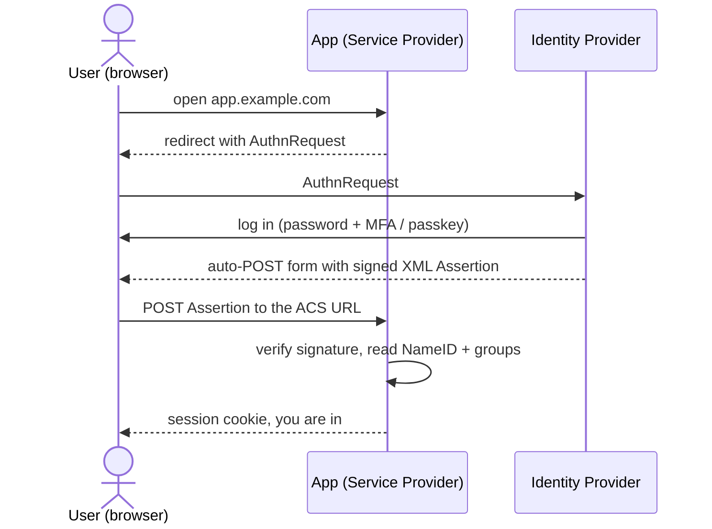
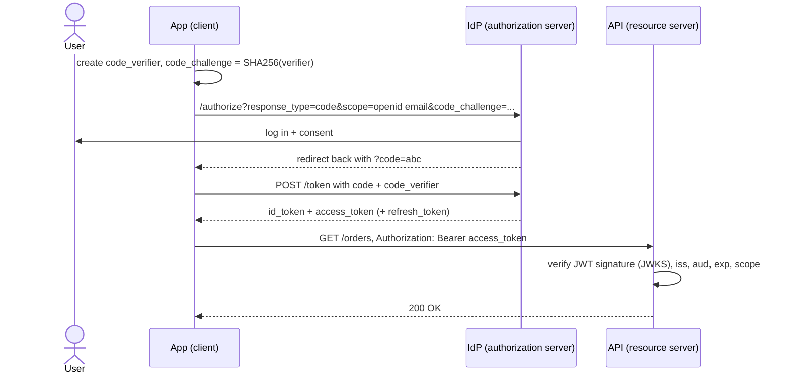

## Context

**Single Sign-On (SSO)** means you log in once, at your company's **identity provider**, and get into Slack, GitHub, AWS and dozens of other apps without typing another password. It's more convenient, and it's *more secure*: one place to enforce MFA, one place to switch off a leaver's access.

## 1. The cast

| Term | Who | Examples |
|---|---|---|
| **User / principal** | The person (or workload) logging in | you |
| **IdP**: Identity Provider | Authenticates users and issues assertions/tokens | Microsoft Entra ID, Okta, Google Workspace, Keycloak, Auth0 |
| **SP / RP**: Service Provider / Relying Party | The app you want to use; trusts the IdP | Slack, AWS, Grafana, your app |

The core idea: the app **never sees your password**. It trusts a **signed statement** from the IdP saying who you are.

## 2. Authentication vs authorization

- **Authentication (AuthN)**: *who are you?* This is OIDC's and SAML's job.
- **Authorization (AuthZ)**: *what may you do?* That's partly OAuth 2.0 (delegated access via scopes), and mostly your app's own roles and policies.

OAuth 2.0 on its own is an **authorization** framework. Using a raw OAuth access token as proof of login was a classic mistake, and it's why **OpenID Connect** was created.

## 3. SAML 2.0: the enterprise veteran

**SAML** (2005) exchanges XML **assertions**, signed with the IdP's certificate, through the browser:



It's still everywhere in enterprise SaaS and AWS IAM Identity Center. It's verbose, browser-only, and XML signature handling has a long history of vulnerabilities, so use a well-maintained library.

## 4. OAuth 2.0 + OpenID Connect: the modern default

**OIDC** is a thin identity layer on top of **OAuth 2.0**, using JSON and **JWTs**. It works for web, mobile, SPAs, CLIs and APIs.

### Authorization Code flow with PKCE



- **PKCE** (the `code_verifier` / `code_challenge` pair) stops a stolen authorization code from being exchanged by an attacker. It's now recommended for *every* client, not just mobile apps.
- **OAuth 2.1** (being finalised at the IETF) consolidates current best practice: PKCE required, and the **implicit** and **password** grants removed.

### The tokens

| Token | For | Audience | Notes |
|---|---|---|---|
| **ID token** (JWT) | Telling the *client* who logged in | the client app | Contains `sub`, `email`, `name`, `iss`, `aud`, `exp` |
| **Access token** | Calling an *API* | the resource server | Often a JWT; short-lived (minutes) |
| **Refresh token** | Getting new access tokens | the IdP | Long-lived; store securely, rotate on use |

### A JWT

A JWT is three base64url parts joined by dots: `header.payload.signature`.

```json
{ "iss": "https://login.example.com", "sub": "user-123", "aud": "orders-api",
  "exp": 1763390000, "scope": "orders:read", "groups": ["platform"] }
```

The API checks it **without calling the IdP**:

1. Verify the **signature** against the IdP's public keys (fetched from its `jwks_uri`).
2. Check `iss`, `aud` and `exp`.
3. Check the scopes or roles.

JWTs are **signed, not encrypted**, so never put secrets in them.

## 5. Machine-to-machine and other flows

- **Client credentials.** A service authenticates as itself, with no user involved.
- **Device authorization flow.** Used by TVs and CLIs: "go to example.com/device and enter ABCD-1234". This is what `gh auth login` and `az login --use-device-code` do.
- **Token exchange / workload identity federation.** A workload trades a token it already has for a cloud credential, with no stored secrets. GitHub Actions OIDC → AWS/Azure/GCP roles, and Kubernetes service account tokens → cloud IAM (IRSA, EKS Pod Identity, Azure Workload Identity), both work this way.

## 6. Around the login

- **MFA and passkeys.** **Passkeys** (WebAuthn/FIDO2) replace passwords with device-bound key pairs. They're phishing-resistant because the browser only signs for the real domain. Major IdPs and consumer platforms now support them broadly.
- **SCIM.** SSO handles *login*. **SCIM** handles *lifecycle*: the IdP automatically creates, updates and deactivates accounts and group memberships in each app, so leavers lose access everywhere.
- **Session management.** Logging out of one app rarely logs you out of the IdP. Keep access tokens short-lived and support revocation.

## 7. SSO for Kubernetes and platforms

- **`kubectl` login.** Configure the API server to trust your IdP (OIDC flags, or the newer **structured authentication configuration**). Users log in via a plugin like `kubelogin`, and RBAC binds to IdP **groups**.
- **Internal tools** (Grafana, Argo CD, Backstage) usually speak OIDC natively. Put anything that doesn't behind **oauth2-proxy** or your gateway's OIDC filter.

## 8. Choosing

| Situation | Use |
|---|---|
| New app, any client type | **OIDC** (Authorization Code + PKCE) |
| Enterprise SaaS that only offers SAML | **SAML** |
| API protecting resources | **OAuth 2.0 access tokens** (JWT validation) |
| Service-to-service | **Client credentials**, mTLS, or **workload identity federation** |
| User provisioning | **SCIM** |

## Lessons learned

SSO moves authentication to one trusted IdP. Apps accept its *signed* statements: SAML assertions or OIDC ID tokens. OAuth 2.0 grants scoped access to APIs. Use Authorization Code + PKCE, short-lived tokens, passkeys for MFA, SCIM for joiners and leavers, and federation instead of long-lived secrets for workloads. Next: **the Linux directory structure**, the filesystem every server and container runs on.
