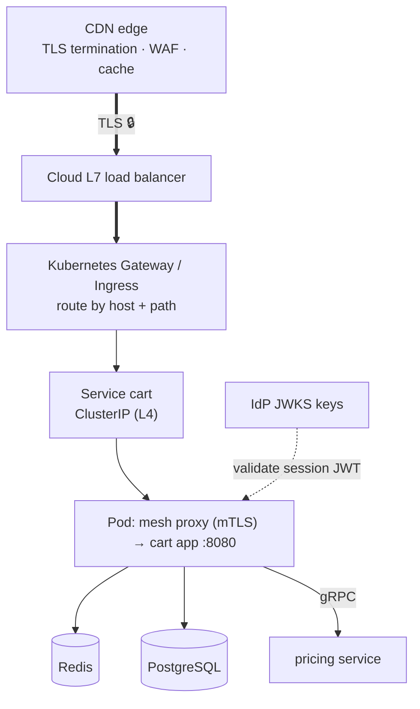
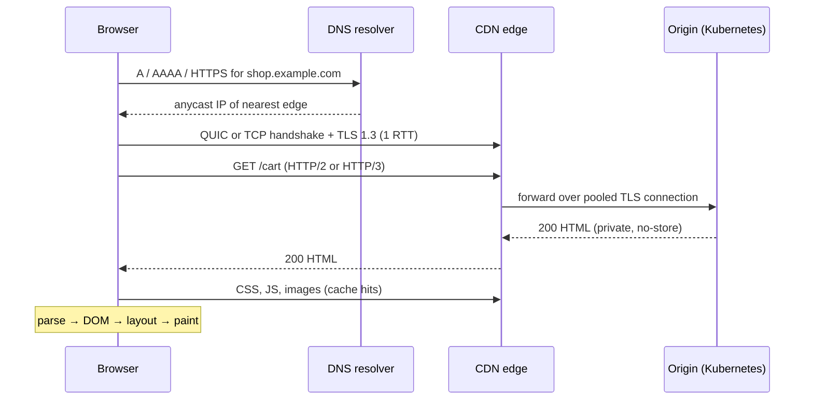

## Context

"What happens when you type `https://shop.example.com/cart` and press Enter?" is the classic systems interview question, because a good answer touches every layer. This part replays the whole Foundations series as one request.

## 0. Before the network: the URL

```text
https://shop.example.com:443/cart?ref=mail#top
└─┬─┘   └──────┬───────┘└┬┘└─┬─┘└───┬──┘└┬┘
scheme       host       port path  query fragment (never sent to server)
```

1. **The browser decides it's a URL, not a search.** It applies **HSTS**: if the site is on the preload list, or sent the HSTS header before, `http://` is upgraded to `https://` before anything leaves the machine.
2. **It checks its caches.** A service worker or the HTTP cache may answer without touching the network at all.

## 1. DNS: name → IP *(Part 5)*

1. **Local caches come first**: browser cache → OS cache → `/etc/hosts`.
2. **Then the recursive resolver** (ISP, `1.1.1.1`, or DoH), which walks root → `.com` → `example.com`'s authoritative servers if needed.
3. **The browser asks for `A`, `AAAA` and `HTTPS` records in parallel.** The HTTPS record may say "I support HTTP/3" and carry ECH keys.
4. **The answer is usually a CDN anycast IP** a few milliseconds away, not the origin.

## 2. Getting there: routing *(Parts 1–3)*

1. **The packet goes to your default gateway.** That's the home router, which NATs your private IP to its public one.
2. **It crosses your ISP**, then peering or transit links chosen by **BGP**, to the CDN's nearest point of presence.
3. **ARP resolves the next hop's MAC address** on each local segment. Every router rewrites the L2 header and forwards on the L3 destination.

## 3. Transport: TCP or QUIC *(Part 4)*

- **HTTP/2 path**: a TCP three-way handshake (1 RTT), then TLS.
- **HTTP/3 path**: QUIC over UDP, where the transport and TLS handshakes are **combined into 1 RTT** (0-RTT on resume).

Browsers often race both and use whichever wins ("happy eyeballs" does the same for IPv6 vs IPv4).

## 4. TLS: trust and encryption *(Parts 7 & 8)*

1. **ClientHello** carries the **SNI** (`shop.example.com`), the **ALPN** list (`h2`/`h3`) and a hybrid post-quantum key share.
2. **The server replies** with its key share and certificate chain, signed to prove it holds the private key.
3. **The browser verifies** the chain up to a trusted root, the SAN matches `shop.example.com`, and the dates are valid.
4. **Keys are derived** and everything from now on is encrypted.

The CDN edge **terminates TLS** here.

## 5. HTTP: the request *(Part 6)*

```http
GET /cart?ref=mail HTTP/2
Host: shop.example.com
Cookie: session=7f3a...
Accept: text/html
Accept-Encoding: br, zstd, gzip
```

At the **CDN edge**:

1. **The WAF and bot checks run.**
2. **The cache is consulted.** `/cart` is personalised, so it's a cache miss. Static assets like `/app.4f2c.js` would be served right here.
3. **The request goes to the origin** over a pooled, re-encrypted connection.

## 6. Inside the platform



1. **The cloud load balancer** forwards to the cluster's **Gateway**. The Gateway matches `HTTPRoute` rules (`shop.example.com`, `/cart`).
2. **The Service** picks a healthy pod. Service-to-service hops are **mTLS** if a mesh is installed.
3. **The cart app validates the session.** Maybe that's a JWT from the **SSO/OIDC** login (Part 9), checked against the IdP's public keys.
4. **The cart app gathers its data.** It reads Redis, queries PostgreSQL (both found via Kubernetes **DNS**: `redis.cart.svc.cluster.local`) and maybe calls the pricing service over gRPC.
5. **The app writes its logs** to stdout, which ends up under `/var/log/pods/` on the node (Part 10) and is shipped to the logging stack. A trace span records the whole path.

## 7. The response travels back

```http
HTTP/2 200
content-type: text/html; charset=utf-8
cache-control: private, no-store
content-encoding: br
strict-transport-security: max-age=63072000; includeSubDomains; preload
```

It flows back through the same connections. The CDN may compress it, but won't cache it (`private, no-store`).

## 8. The browser renders

1. **Parse the HTML** and build the **DOM**.
2. **Discover sub-resources** (CSS, JS, fonts, images) and fetch them. They're multiplexed over the *same* HTTP/2 or HTTP/3 connection, and are mostly CDN cache hits.
3. **Build the CSSOM**, run JavaScript, then **layout → paint → composite**.
4. **JavaScript may call APIs** (`fetch('/api/cart')`), which repeats steps 5–7 and triggers **CORS** checks if they're cross-origin.

## 9. The whole thing on one timeline



| Step | Typical cost | Saved by |
|---|---|---|
| DNS | 0–50 ms | Caching, TTLs, nearby resolvers |
| TCP + TLS (or QUIC) | 1–2 RTT | HTTP/3, TLS 1.3, connection reuse, 0-RTT |
| Edge → origin | 10–100 ms | CDN caching, pooled origin connections |
| Server work | 5–500 ms | Caching, indexes, fewer hops |
| Rendering | 50–1000+ ms | Smaller JS, critical CSS, image formats |

## Lessons learned

One Enter key touches every layer: DNS resolves the name, BGP and IP routing carry packets, TCP or QUIC carry bytes, TLS proves identity and encrypts, HTTP carries meaning, and load balancers, gateways and Kubernetes route it to a pod that authenticates you via SSO tokens and writes logs to `/var/log`. If you can explain each hop, you can debug any of them. That's the point of Foundations.

---

*That completes the Foundations series. Continue with [Infra for AI](../infra-for-ai-01-hardware/), which builds on these basics to run GPUs, LLMs and ML pipelines in production.*
